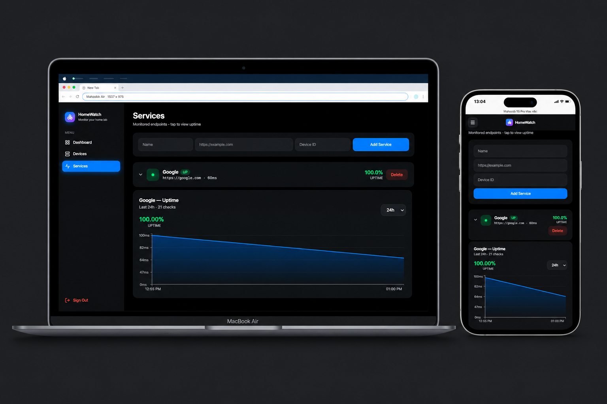

<p align="center">
  
</p>

<h1 align="center">HomeWatch</h1>

<p align="center">
  <strong>Self-hosted home lab monitoring — Go + Next.js + PostgreSQL + Docker</strong>
</p>

<p align="center">
  
  
  
  
  
</p>

---

## What it does

**HomeWatch** is a lightweight, self-hosted monitoring dashboard for home labs and small IT environments. Track every device, ping every service every 15 seconds, and visualize uptime — all from one Apple-inspired interface.

| Feature | How |
|---------|-----|
| **Device inventory** | Catalog hardware (servers, Pi's, routers, NAS) with type, IP, location, tags |
| **Service monitoring** | Register HTTP endpoints per device; auto-check every 15 seconds |
| **Response time tracking** | Each check records latency in ms |
| **Uptime history** | 5-minute bucketed time series stored in `service_pings` |
| **Uptime percentage** | Live 24h %; green ≥ 99%, orange ≥ 95%, red < 95% |
| **Range selection** | Chart intervals: 1h · 6h · 24h · 7d |
| **JWT authentication** | bcrypt + HMAC-SHA256 with 24h expiry |
| **Responsive UI** | Apple-inspired glassmorphism, dark mode, mobile drawer |
| **Auto-cleanup** | Pings older than 7 days deleted hourly |
| **One-command deploy** | `docker compose up` runs API + DB + web |

---

## Quick Start

**Prerequisites:** Docker Desktop ≥ 24 (with Compose v2)

```bash
git clone https://github.com/YOUR-USERNAME/HomeWatch-FullStack-Go-Gin-NextJS-PostgreSQL-Docker.git
cd HomeWatch-FullStack-Go-Gin-NextJS-PostgreSQL-Docker
docker compose up --build
```

Open **http://localhost:3000**:

1. Click **"Don't have an account? Register"**
2. Register (any email + password min 6 chars)
3. **Devices** → Add "Raspberry Pi" (type: `pi`, IP: `192.168.1.10`)
4. **Services** → Add "Google" (`https://google.com`, Device ID: 1)
5. Wait ≤15 seconds → status flips to **UP** 🟢
6. Click chevron on the service to reveal the uptime chart

**Test failure detection:** add `Broken` with URL `https://this-does-not-exist-12345.com`. Flips to **DOWN** 🔴 within 15 seconds.

First run takes ~3 minutes while Docker pulls Go and Node images.

---

## Architecture

```text
┌──────────────────────────────────────────────────────────┐
│                  Next.js 14 (App Router)                 │
│   Login · Dashboard · Devices · Services · Uptime Chart  │
└───────────────────────┬──────────────────────────────────┘
                        │  REST + JWT Bearer
                        ▼
┌──────────────────────────────────────────────────────────┐
│                    Go 1.26 API (Gin)                     │
│  Auth (bcrypt/JWT) · CRUD · Health Checker (15s)         │
└───────────────────────┬──────────────────────────────────┘
                        │  GORM
                        ▼
┌──────────────────────────────────────────────────────────┐
│                    PostgreSQL 16                         │
│  users · devices · services · service_pings              │
└──────────────────────────────────────────────────────────┘
```

### Directory layout

```text
.
├── api/                          Go backend
│   ├── main.go                   Routes + CORS + bootstrap
│   └── internal/
│       ├── auth/                 bcrypt + JWT (+ tests)
│       ├── config/               Env-based config
│       ├── db/                   GORM + migrations
│       ├── handlers/             HTTP handlers (+ tests)
│       ├── healthchecker/        Background goroutine
│       ├── middleware/           JWT guard (+ tests)
│       └── models/               GORM models
├── web/                          Next.js frontend
│   ├── app/                      App Router pages
│   ├── components/               Sidebar, StatCard, UptimeChart
│   └── lib/api.ts                Fetch wrapper + tokens
├── docs/screenshots/             Hero image for README
└── docker-compose.yml            3-service orchestration
```

---

## Health Checker

`api/internal/healthchecker/checker.go` runs a `time.Ticker` every 15 seconds. On each tick, it pings every service in parallel using goroutines:

```go
for _, s := range services {
    go func(s models.Service) {
        start := time.Now()
        resp, err := client.Get(s.URL)   // 5s timeout
        ms := 0
        status := "down"
        if err == nil {
            resp.Body.Close()
            status = "up"
            ms = int(time.Since(start).Milliseconds())
        }
        db.DB.Model(&models.Service{}).
            Where("id = ?", s.ID).
            Updates(map[string]interface{}{
                "status": status, "response_ms": ms,
                "last_checked_at": time.Now(),
            })
        db.DB.Create(&models.ServicePing{
            ServiceID: s.ID, Status: status,
            ResponseMs: ms, CheckedAt: time.Now(),
        })
    }(s)
}
```

**Why Go for this?** 50 services × 15s = ~3.3 req/s. Goroutines ping all in parallel with a 5s timeout each. `CGO_ENABLED=0` produces a static binary in a ~15MB Alpine image.

---

## Uptime Chart

Historical data is bucketed into 5-minute windows using SQL aggregation:

```sql
SELECT
  date_trunc('hour', checked_at) + (EXTRACT(minute FROM checked_at)::int / 5) * INTERVAL '5 minutes' AS bucket,
  AVG(response_ms) AS avg_ms,
  COUNT(*) FILTER (WHERE status = 'up')   AS up_count,
  COUNT(*) FILTER (WHERE status = 'down') AS down_count
FROM service_pings
WHERE service_id = $1 AND checked_at >= $2
GROUP BY bucket ORDER BY bucket ASC;
```

- **7-day retention** — old pings deleted hourly
- **Indexed** on `(service_id, checked_at)` — queries < 10ms
- **Rendered with Recharts** — Area chart with `[1h / 6h / 24h / 7d]` selector

---

## Security Model

1. **Password hashing** — bcrypt (default cost), never returned (`json:"-"`)
2. **JWT middleware** — every protected route validates HMAC-SHA256
3. **Token expiry** — 24h from issue

```go
if !strings.HasPrefix(h, "Bearer ") {
    c.AbortWithStatusJSON(401, gin.H{"error": "missing token"})
    return
}
claims, err := auth.ParseToken(secret, tokenStr)
if err != nil {
    c.AbortWithStatusJSON(401, gin.H{"error": "invalid token"})
    return
}
c.Set("userID", uint(claims["sub"].(float64)))
```

Secrets stay server-side. The frontend only ever holds the signed JWT.

---

## API Reference

All routes prefixed with `/api`. `/register` and `/login` are public; the rest require `Authorization: Bearer <token>`.

| Method | Route | Body | Returns |
|--------|-------|------|---------|
| POST | `/register` | `{email, password}` | `{token, user}` |
| POST | `/login` | `{email, password}` | `{token, user}` |
| GET | `/me` | — | `User` |
| GET | `/devices` | — | `Device[]` |
| POST | `/devices` | `{name, type, ip, location, tags}` | `Device` |
| PUT | `/devices/:id` | `Device` | `Device` |
| DELETE | `/devices/:id` | — | `{ok}` |
| GET | `/services` | — | `Service[]` |
| POST | `/services` | `{name, url, device_id}` | `Service` |
| PUT | `/services/:id` | `Service` | `Service` |
| DELETE | `/services/:id` | — | `{ok}` |
| GET | `/dashboard` | — | `{devices, services, up, down}` |
| GET | `/services/:id/uptime?hours=24` | — | `{series, uptime_pct, ...}` |
| GET | `/uptime/summary` | — | `Summary[]` |

---

## Testing

```bash
docker run --rm -v "$(pwd)/api:/app" -w /app golang:1.26-alpine \
  sh -c "go test ./... -v"
```

**12 tests passing** across 3 packages:

```text
PASS homelab/internal/auth        (7 tests)
PASS homelab/internal/handlers    (2 tests)
PASS homelab/internal/middleware  (3 tests)
```

Covers: bcrypt round-trip, JWT lifecycle (sign → parse → expiry), middleware guards, request validation.

---

## Tradeoffs

| Decision | Why |
|----------|-----|
| **Polling (5s), not WebSockets** | Stateless, cache-friendly, horizontally scalable without sticky sessions |
| **5-minute ping buckets** | 288 points per service per 24h — enough to spot patterns, cheap to render |
| **7-day ping retention** | Debug weekly trends without bloating the DB |
| **CGO disabled** | Static binary, ~15MB Alpine image, no libc dependency |
| **JWT in localStorage** | Simple for a single-user demo; migrate to `httpOnly` cookies for production |

---

## Roadmap

- [ ] Server-Sent Events — push status changes in real time
- [ ] Webhook alerts — POST to Slack/Discord on DOWN
- [ ] Dependencies graph — React Flow visualization
- [ ] Dark / light mode toggle
- [ ] Multi-user + teams

---

## Tech Stack

| Layer | Choice |
|-------|--------|
| Backend | Go 1.26 · Gin · GORM |
| Database | PostgreSQL 16 |
| Frontend | Next.js 14 · React 18 · Tailwind · Recharts · Lucide |
| Auth | JWT (HS256) · bcrypt |
| Deploy | Docker Compose (api, web, db) |
| Design | Apple-inspired dark UI — glassmorphism, SF Pro, system accents |

---

<p align="center">
  <sub>Built with Go, Next.js, and an unhealthy obsession with uptime charts.</sub>
</p>